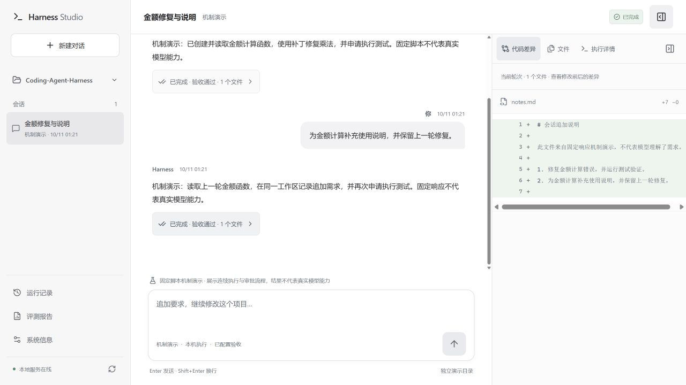
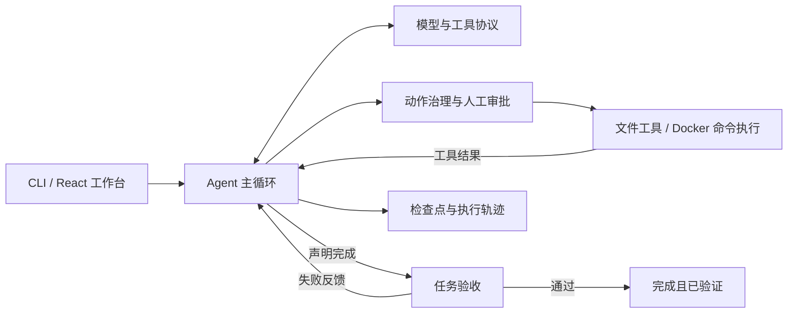

# Coding Agent Harness

[](https://github.com/xujianghu/Coding-Agent-Harness/actions/workflows/ci.yml)

**可验收、可恢复的编码 Agent 执行框架，配套 CLI 与 React 会话工作台。**

将模型工具调用、动作治理、隔离执行、失败反馈与检查点恢复连接成可追踪的开发流程；通过独立验收，区分“模型认为完成”和“代码通过检查”。适合学习 Coding Agent 工程、构建本地编码助手，以及研究反馈机制对任务结果的影响。

当前源码版本为 `1.1.0`，升级内容位于 [`codex/agent-harness-upgrade`](https://github.com/xujianghu/Coding-Agent-Harness/tree/codex/agent-harness-upgrade) 分支。请从源码安装；该说明不代表此版本已发布到 npm。



文档更新：2026-10-11。

## 核心能力

| 能力 | 当前实现 |
| --- | --- |
| 模型与工具协议 | OpenAI、Anthropic、Gemini 原生工具调用；调用 ID 与结果对应；文本 JSON 动作回退 |
| 仓库操作 | 文件读写与删除、文件搜索、字面代码搜索、分段读取；精确补丁支持 SHA-256 检查，拒绝过期修改与多处匹配 |
| 治理与审批 | 文件边界、护栏规则、命令白名单与人工审批；审批后重新校验策略 |
| 隔离执行 | 命令默认使用 Docker，限制网络、权限、资源与输出；支持超时和取消清理 |
| 验收与修复 | `completed` 与 `verified` 分离；配置验收后，失败反馈进入下一轮修复 |
| 预算与恢复 | 轮次、时间、Token 预算；完整工具消息组成组裁剪；检查点、执行轨迹与安全恢复 |
| 会话工作台 | 连续追加需求、执行状态、审批、取消与恢复；只读文件浏览、逐轮 Diff、历史与评测报告 |
| 对照评测 | 10 个冻结修复任务，支持 `baseline`、`full`、`no-feedback`；独立隐藏验收与逐次结果记录 |

## 无需 Key 的快速演示

需要 **Node.js 22.12+（22 系列）或 24+** 和 npm。以下演示不需要模型 Key 或 Docker。

```bash
git clone --branch codex/agent-harness-upgrade https://github.com/xujianghu/Coding-Agent-Harness.git
cd Coding-Agent-Harness
npm ci
npm run build
node dist/cli/index.js init
npm run web
```

打开终端输出的本地地址，默认是 `http://127.0.0.1:4173`：

1. 新建“机制演示”会话，发送“修复金额计算错误，并运行测试验证”。
2. 查看文件创建、读取和补丁事件，在验收审批处批准执行。
3. 查看任务结束与验收通过状态，打开文件面板和 Diff。
4. 继续发送“为金额计算补充使用说明”，查看第二轮记录；刷新页面检查会话持久化。

演示会真实操作独立目录中的文件并运行固定测试，模型响应来自预设脚本。它验证执行机制，**不代表能够离线理解任意任务，也不衡量真实模型编码能力**。完整步骤见 [快速开始](docs/getting-started.md) 和 [项目演示](docs/project-showcase.md)。

## 执行真实任务

真实任务需要可用模型凭据和已启动的 Docker。先将下面的 `../your-project` 替换为目标项目路径；在 Harness 仓库根目录执行：

```bash
node dist/cli/index.js init --workspace ../your-project
docker pull node:22-alpine
```

检查目标项目的 `.harness/config.yaml` 中的 `provider`、`model` 和可选 `baseUrl`。仓库自带的是无密钥 OpenAI 兼容服务配置示例，`init` 不会覆盖已有配置；请按实际服务调整。通过对应的 `OPENAI_API_KEY`、`ANTHROPIC_API_KEY` 或 `GEMINI_API_KEY` 环境变量提供凭据，然后执行：

```bash
node dist/cli/index.js run "修复分页边界错误，保持现有接口并补充回归用例" --workspace ../your-project --verify "npm test"
```

这个示例面向使用 `npm test` 的 Node.js 项目，请按实际项目修改验收命令。默认容器禁止联网，必须提前准备 Linux 兼容依赖或包含依赖的执行镜像；`node:22-alpine` 不包含 Maven、JDK 或 Git。Java 项目需要单独准备执行镜像和命令白名单，详见 [配置与执行环境](docs/configuration.md)。

任务会修改目标工作区；建议使用 Git 跟踪初始状态。未指定 `--verify` 时，即使模型声明完成，`verified` 仍为 `false`。恢复中断任务可使用 `node dist/cli/index.js session resume <id> --workspace ../your-project`；恢复保留原预算，并检查工作区、配置与执行状态是否一致。

## 执行流程



会话中的新消息创建新运行，继承经过校验的历史上下文并开启新预算；恢复操作继续原运行与累计预算。历史工具结果不会自动重放，结果未知的动作会阻止自动恢复。协议和边界详见 [架构说明](docs/architecture.md)。

## 评测与验证

评测使用相同任务、模型、工具与预算，比较三种完成反馈机制：

| 模式 | 模型声明完成后的处理 |
| --- | --- |
| `baseline` | 停止执行，交由独立隐藏验收评分 |
| `full` | 运行公开测试，将失败诊断反馈给模型继续修复，再独立评分 |
| `no-feedback` | 保留测试失败状态，移除失败诊断，再独立评分 |

每次尝试使用独立工作区；隐藏验收在候选工作区之外，评分检查允许修改范围，并记录失败尝试、补丁、轨迹、用量与复现信息。

```bash
npm test
npm run eval:smoke
npm run test:package
```

升级实现 [`9615b77`](https://github.com/xujianghu/Coding-Agent-Harness/commit/9615b7752d278b0c0ac51e6966a1f1f763c1b01c) 的工程验证记录：**351 个测试通过、10 个跳过；离线机制自检 30/30 通过**（10 个任务 × 3 种模式）。这是工程测试与固定脚本自检结果，**仓库尚未提供真实模型成功率数据**；当前任务集也不覆盖大型仓库或 Java 工程。

真实评测在配置和凭据准备完成后执行，会产生 API 费用，并强制使用 Docker：

```bash
node dist/eval/cli.js --config .harness/config.yaml --mode all --repeat 3
```

报告默认保存在 `.harness/eval-results/<run-id>/`，包含逐次结果、候选代码、差异与调用轨迹。实际 usage 与估算 usage 分开记录，未核实的费用保持未知。任务、评分协议和实验方法见 [评测指南](eval/README.md)，开发检查见 [开发与验证](docs/development.md)。

## 当前边界

- 工作台面向本机单用户，只监听回环地址；一次服务固定一个工作区，同时执行一个 run，不提供多用户或公网部署能力。
- 不同真实会话共享启动工作区，尚未实现每会话 worktree；文件面板只读，Diff 为有界预览。
- SSE 推送执行快照，尚未实现模型逐 Token 输出或执行中追加指令。
- Docker 不可用时不会自动退回 `local`；显式 `local` 执行拥有宿主用户权限，不提供容器隔离。
- 目前没有产品内置多 Agent 调度、MCP 扩展、语义仓库索引或 Java 评测集。

更完整的凭据、文件与执行边界见 [配置与执行环境](docs/configuration.md) 和 [架构说明](docs/architecture.md)。

## 仓库结构

```text
src/
  core/          主循环、上下文、预算与检查点协议
  llm/           模型提供商与 mock 适配
  tools/         文件、搜索、补丁与命令执行器
  governance/    护栏、审批、工作区边界与审计
  cli/           任务入口、检查点与执行轨迹
  web/           本地工作台 API、会话与运行管理
  eval/          评测运行、独立评分与报告
frontend/        React / TypeScript / Vite 工作台
eval/            冻结任务、公开测试、隐藏验收与 mock 解法
tests/           回归、集成与 Docker 测试
scripts/         安装包与容器验证脚本
demo/            执行机制演示
docs/            使用、设计、开发与展示文档
  history/       早期设计与开发记录
.github/         持续集成与仓库协作配置
```

## 文档导航

| 文档 | 内容 |
| --- | --- |
| [快速开始](docs/getting-started.md) | 环境准备、离线演示、真实任务与常见问题 |
| [配置与执行环境](docs/configuration.md) | 模型、凭据、预算、Docker 与治理规则 |
| [架构说明](docs/architecture.md) | 工具协议、会话、验收、恢复与隔离边界 |
| [评测指南](eval/README.md) | 任务集、独立评分、对照实验与报告 |
| [开发与验证](docs/development.md) | 本地开发、测试、构建与 CI |
| [参与贡献](CONTRIBUTING.md) | 问题反馈、修改提交与文档约定 |
| [项目演示与简历表达](docs/project-showcase.md) | 五分钟演示、实现贡献与证据要求 |
| [改进路线图](docs/roadmap.md) | 实施优先级、交付目标与验证方式 |
| [历史材料](docs/history/) | 早期规格、计划与开发记录，不作为当前功能说明 |

## 改进路线图

- **P0：** 真实模型对照评测、Java/Maven 任务、仓库索引与上下文压缩。
- **P1：** 会话独立 worktree、Git 修改审查与交付、模型流式输出与安全追加指令。
- **P2：** Skills / MCP 扩展、受控任务规划与多 Agent、效果和成本分析。

这些是后续计划。验收标准与依赖关系见 [改进路线图](docs/roadmap.md)。
