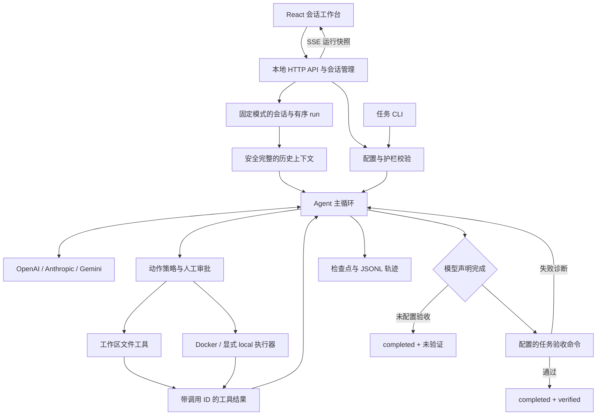

# 架构与验证边界

Harness 负责模型交互、工具执行和预算管理，编码任务的正确性通过独立检查决定。宿主 Node.js 进程持有模型连接、配置和审批界面；任务命令使用独立执行器。

## 模型与动作协议

工具定义包含名称、参数和执行函数。原生协议中的一条模型响应可以包含多个调用，主循环逐个治理和执行，并为每个调用 ID 写入结果。上下文裁剪以完整消息组为单位，避免保留调用却丢弃结果。文本模型可回退到 JSON 动作解析；解析失败需要反馈和重试，不能当作成功结束。

文件定位使用 `search_files`、`search_code`、`read_file_lines`。`search_code` 按字面字符串查找，输出文件、行号和文本。`apply_patch` 在单一匹配处替换文本，支持预期 SHA-256，避免把整文件覆盖当作默认编辑方式。

## 本地工作台

React 前端组织会话列表、连续 Markdown 对话、消息输入和右侧文件/Diff/执行面板。创建会话仅保存元数据，不调用模型；消息提交后创建新的 run，任务服务使用同一 Agent 主循环、工具与治理管道。审批决定在服务端重新校验；取消通过 AbortSignal 传递到模型请求、审批等待与执行器。

会话与 run 分开保存：会话固定 mock/real 来源、执行模式、验收命令及配置/护栏哈希，`runIds` 记录有序运行，用户和助手展示消息关联到对应 run。`.harness/web-conversations/<id>.json` 保存会话，`.harness/web-runs/<id>.json` 保存运行元数据，`.harness/runs/<id>.jsonl` 保存执行轨迹；检查点仍由原会话存储模块维护。

发送后续消息时，从该会话最近一次检查点提取模型消息，通过结构校验后作为新 run 上下文。校验要求工具调用 ID 与结果完整配对，并拒绝结果未知或 pending 调用；历史动作只作为已完成消息继承。新任务消息在上下文裁剪中保留，较旧消息按完整组裁剪。新消息开启新预算，恢复继续原 run 的累计预算。配置或护栏哈希改变时拒绝发送，要求创建采用新配置的会话。

实时接口 `GET /api/runs/:id/events` 使用 SSE，事件名为 `run`，数据是包含状态、审批、工具活动和有界事件尾部的完整 WebRun 快照。订阅先返回当前快照，再推送变化；慢客户端只保留最新快照。它不传输模型逐 Token 流，页面的实时性来自执行事件和完整模型响应。

文件浏览接口只读会话对应工作区，逐级检查路径，隐藏敏感状态和凭据，拒绝链接、二进制及超出限制的文件。文件预览展示当前磁盘内容；Diff 来自所选 run 的前后内容预览，不是完整 Git 历史，也可能受大小和文件数量限制截断。浏览器不能直接修改代码。

服务固定启动时的一个工作区，仅监听回环地址，同一时刻只允许一个活动 run。不同真实会话共享该工作区，当前没有多项目切换或每会话 Git worktree。HTTP 层验证 Host、Origin、JSON 内容类型和请求大小，静态资源路径不能越界。前端不获取或保存模型密钥，已有凭据由宿主 Agent 进程使用；服务面向本机单用户，不提供登录或远程多租户边界。

演示会话在 `.harness/web-demo/<conversationId>/` 共享独立工作区。首轮预设响应创建错误的 `amount.js`、读取文件并用补丁改为乘法；后续轮读取修复结果，向 `notes.md` 记录追加需求。文件工具和固定测试真实执行，模型决策来自固定脚本，不衡量任意任务理解能力。页面分别显示任务状态与验收状态，报告页只读取已有产物。

历史保留工作台、命令行与模型/mock 的执行来源。CLI 离线自检和来源未知的旧记录不能从工作台切换到真实模型恢复，应使用原 CLI 模式。没有检查点的启动失败记录仍可查看错误，但不能恢复；已有安全上下文时可在会话继续提交新消息。重启时读取已落盘的会话与运行，并对同一运行编号去重。

## 执行边界

文件工具在宿主执行，每次解析真实工作区路径，拒绝越界、敏感条目和不安全链接。命令工具共享执行器，因此 `run_test`、`run_lint` 与 `shell_exec` 使用相同超时、取消、环境变量和隔离设置。

Docker 任务使用可写工作区挂载、只读根文件系统、禁网、权限和资源限制。已有敏感条目以只读空挂载覆盖，API Key 不传入容器。容器运行时不拉取镜像，也不安装联网依赖。`.git` 被遮蔽，容器中的 Git 操作无法读取宿主仓库元数据。

显式 `local` 模式只控制策略、输出、超时和进程树，不限制命令读取宿主文件。框架不会在 Docker 失败后回退到本地。

护栏文件在启动时进行结构与正则校验，运行时热加载失败保留旧规则。人工审批后重新走策略，仍然拒绝硬性路径或命令违规。审计与轨迹用于复查决策，不替代执行隔离。

## 预算、验收与恢复

Agent 受模型调用轮次、累计执行时间、累计 Token 限制。估算 usage 会在结果中标记。一次 `done` 只表达模型认为完成；配置 `onVerify` 或 CLI `--verify` 时，还需要验证通过才能设置 `verified`。失败反馈会继续进入循环，预算不会重置。

检查点保留任务、模型消息、历史工具结果、pending 调用和累计预算。会话封装记录配置/规则哈希及工作区指纹，恢复先检查一致性。指纹忽略依赖、构建产物和 Harness 自身输出，不是完整环境快照。

若工具开始执行后取消或崩溃，动作结果可能不确定。恢复拒绝自动重放这些动作，避免重复写入或重复副作用。工作区改变、配置改变、验收命令改变或原 run 已完成时，恢复会被拒绝。工作台后续消息是新的运行，继承经校验的完整上下文，不复用旧 run 的轮次、Token 和时间计数；已有上下文的输入用量仍会计入新运行预算。

## 独立评测

评测 Runner 按任务和模式复制独立工作区，固定模型、工具与预算；公开测试是模型可见反馈。任务允许修改的源码列表被冻结，评分时检查候选变更，拒绝修改测试、配置和其他文件。

隐藏验收放在工作区之外，断言由可信父进程执行。候选实现通过独立进程或禁网只读容器中的受限调用协议返回函数结果，父进程只根据结果与断言评分。候选进程打印标记、伪造测试输出或退出 `0` 不能让父进程自动认定成功。

`baseline` 不做完成前的公开测试验证；`full` 提供失败诊断并允许修复；`no-feedback` 保留失败事实、隐藏诊断。这是对反馈机制的受控比较，不是对模型训练或多智能体规划的评价。

真实评测记录模型 usage 和估算 usage，费用未配置时保持未知，失败与中断都计入尝试。mock 运行预设解法，因此只验证 Harness 机制。当前任务集为 10 个轻量 JavaScript 修复任务，尚不覆盖大型仓库、Java 工程、联网依赖和外部服务。

## 交付验证

单元与集成测试覆盖调用协议、治理拒绝、文件边界、恢复和评分，以及工作台审批、取消、历史与 HTTP 边界。Docker 测试检查真实容器边界及清理；打包测试检查安装后的 CLI、任务资产、前端静态页面与工作台 API。GitHub Actions 的 Windows/Ubuntu 矩阵运行无需模型 Key 的检查，独立 Ubuntu 任务运行 Docker 检查。真实模型效果需要单独运行评测并保留报告。
